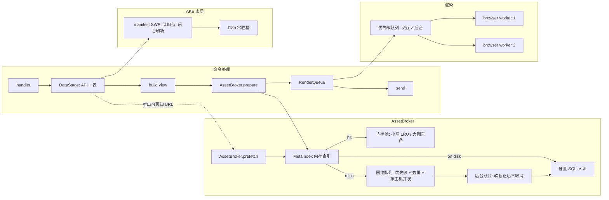

# 缓存与请求体系改造方案：以查询响应延迟为主矛盾

状态：实施中·第二期（分支 `feat/cache-request-phase2`）。第一期已合入 `main @ ef3ec25`（v1.28.0）并上线沈阳云；第三、四期未开始。基线 `main @ ef3ec25`（v1.28.0）。

## 主人拍板（已定，实施须遵守）

- **Q1A**：软截止后不补发完整图
- **Q2B**：card_detail 同用户同角色 60s 内存复用（仅内存、不落盘、key 含凭据指纹）——属第四期，第一期不做
- **Q3C**：改用 Playwright async API（第三期；第一期不做）
- **Q4B**：查询后回填 + card_detail 预取 + 启动热集预取，日限 300MB，hycdn 代理不预取（第二期）
- **Q5A**：立绘保持原图
- **Q6A**：小图池 64MiB + I18n 常驻 ~45MiB + 表池 64MiB ≈180MiB
- **额外偏好**：大文件以本地磁盘缓存为主（大图不进内存池、走磁盘直通，与方案 L2 一致）

## 第一期落地记录

§5 第一期六项全部完成，与下文方案的出入：

- **校验标记不改表结构**：`verified_at` 只记在进程内的元数据索引里（首读校验一次，24 h 内信任，重启后首读重新校验），不加列、不升 `user_version`，回滚旧版本零迁移。代价是本进程已校验过的行若之后在磁盘上损坏，最多 24 h 内会被复用（方案里「PNG 解码失败兜底删除」在代码里并不存在）。
- **大图直通只对有磁盘副本的生效**：素材池同时承载日历图、雷达页面等非白名单大文件，一刀切按 1 MiB 不进池会让它们每次重下。实现为 `max_entry_bytes` + `may_bypass`，只有磁盘上已有（或已排队写入）同样正文的才跳过内存。
- **I18n 常驻槽**：只放当前版本的 `I18nTextTable_CN`（EN 仍在表池），新鲜副本按调用方 TTL（24 h）常驻，不跟服务器 max-age 过期；私有 / no-cache / 旧副本仍按原截止时间。
- **`?v=` 改为重新校验**：表路径不再带 token；同一个 token 下每张表只发一次条件请求，所以一批刷新里档案与蚀刻章共用的 I18n 仍只校验一次。
- **manifest SWR 的失败处理**：刷新失败时保留上一份并把它放回「旧值可用」窗口，30 s 后后台重试、告警 5 min 一条，调用方不再等失败的网络；从未取到过才报错。换版本（`latest` 或 `sharedRevision` 变化）时清 akedata 内存缓存并让冷启动检查重新判冷，不做预热（第二期）。
- **请求头指纹**：按 httpx 的合并规则直接算（默认头 + `Host` + 调用方头），与 `build_request` 逐字节一致；客户端带 cookie、相对 URL、非 ASCII 或大小写重复的头仍走 `build_request`。新下载的公共图片在事件循环外算一次 digest，交给写线程复用。

本地验证（开发机，不是 em）：

- 跨版本：19fd049 写的磁盘行，新代码断网读取 0 次网络请求（表经 `_get`，图片经分流 `mem=0 disk=2 net=0`）；`check_endfield_public_cache.py` 图片与表都是 200 → 0 次 → 304。
- 233 个素材（232 张约 60 KB 图标 + 一张 16.8 MB 立绘，MockTransport）经 `cards._prepare_assets`：内存清空、磁盘新鲜 0.150 → 0.063 s；紧接着再取 0.077 → 0.037 s；容量淘汰 186 → 0。
- 账号卡 `--warm-gap 90` 基准需要账号凭据与终端输入，未在本机跑；上线前在 em 跑 §5 的命令核对。

## 第二期落地记录

§5 第二期五项在 `feat/cache-request-phase2` 完成（v1.29.0，未推送、未上线）。`otae_bot/infrastructure/http/assets.py`
的 `AssetBroker` 管优先级网络队列（交互 > 续传 > 预取，总并发之内按主机限流）、同 URL 去重、软 / 硬截止续传、
预取与每日流量；`fetch_many_resilient` 只剩一层转发，签名与 `(resources, failures)` 返回形状不变，三份
`_prepare_assets` 与 `_resolve_asset_groups` 不用改调用就走 broker。与方案 / brief 的出入：

- **不新增 `soft_deadline` / `priority` 参数**：软截止仍是 `budget_seconds` / `asset_render_budget` 经
  `batch_deadline` 换算出的时间，查询批次固定为交互优先级；调用方没有要传别的值的场景。批次的
  mem / disk / net / net_304 / 续传数挂在返回值的 `.stats` 上（元组子类，测试替身返回裸 dict 照常兼容），
  由 `RenderHealth` 累加进 `account-render ... net= net_304= refill=`；`_PreparedAssets` 不加字段。
- **broker 的下载不经内存池的共享 fill**（`fetch_bytes(coalesce=False)`）：池里的 fill 被 `shield` 保护，
  取消不到；broker 自己按 `(命名空间, 改写后 URL, 请求头指纹)` 去重，硬截止与关闭因此能真正取消下载。
  其余 `fetch_bytes` 调用仍走池合并。原来的素材信号量删掉，所有素材请求（含 B 站卡等单独的
  `fetch_bytes(asset=True)`）都排进同一个优先级槽位，单独调用按交互优先级。
- **热集在 broker 里记**：每个交互批次把用到的、能落盘的公共图片（无自定义请求头）连同命名空间与
  借用命名空间记下，不只是资料卡的 `_prepare_assets`。状态文件 `asset-hotset.json` /
  `asset-prefetch-budget.json` 放在公共图片缓存旁（默认 `data/cache/`），不放 `data/endfield/`：
  基础设施层不认识插件目录，测试换掉磁盘缓存时也随之隔离。
- **不加 `_IndexRow.size`**：热集记账时就知道体积，启动预取按记下的体积从小到大、跳过 > 1 MiB 的大图。
- **流量在收到正文时就计**（不是 job 结束时）：排队中的预取在当天额度用完后拿到槽位即放弃、不发请求，
  最多超出一张图。304 与磁盘命中不计。预取只试一次，不重试（下次查询会再取）。
- **账号卡预取的 URL**：`account/prefetch.py::detail_asset_urls` 与账号详情卡实际用到的图一致（头像、
  `avatarSqUrl`、技能 / 武器 / 装备 / 战术道具图标），另加 AKE 职业 / 属性图标（干员卡在用）；
  `avatarRtUrl` / `recordAvatarUrl` 详情卡不画，不预取。`/ef 日常` 拿到 detail 后也预取（`source=daily`）。
- **三方互借**：`endfield-assets` / `endfield-gacha-images` / `endfield-account-ui-assets` 互借磁盘副本，
  账号总览卡的 `_prepare_assets` 补上 `disk_aliases`。
- **`persist_detail`** 自身改为线程里解析与写库；`_card_detail_with_snapshot` 把它丢进后台任务，Cleanup 时取消。
- **未做 brief 的 2b（过期行 SWR）**：需主人点头，本期只让 `net_304` 可见（`HttpResource.revalidated`）。
- **hycdn 默认并发 4 的代价**：按方案默认 `hycdn.cn=4,fz.wiki=2,warfarin.wiki=2`。只打一个主机的大批量
  （账号卡两百多张 hycdn 图）在图床本身是瓶颈时，软截止前能拿到的张数约减半（下面模拟 112 vs 224），
  换来慢图床不再占满全部槽位、其它主机的交互请求不排队。需要时用
  `OTAE_HTTP_ASSET_HOST_CONCURRENCY=hycdn.cn=8,fz.wiki=2,warfarin.wiki=2` 调回。

本地验证（开发机，不是 em）：

- 全量 `pytest -q`：2360 passed / 2 skipped（加 changelog 条目后）；新增 `tests/test_http_asset_broker.py`
  18 例（续传、取消不传播、硬截止、优先级与抬升、按主机并发、去重、预取不进内存、日限与跨日、
  代理主机不预取、队列上限、热集与重启）连跑 20 次无失败；`tests/test_endfield_asset_prefetch.py` 9 例；
  `/ef 日常` 三账号并行 < 0.6 s（串行 0.9 s）。
- §5 复现（MockTransport，232 张 60 KB 图标都在 hycdn、每张 0.1 s、软截止 3 s）：第一次 3.01 s 返回，
  112 张到位、120 张转续传，续传在之后 2.99 s 内全部落盘；清空内存再查 0.047 s，`disk=232 net=0`。
  同一场景关掉按主机限流：224 张到位、8 张续传。每张 0.05 s：224 / 8，再查 0.044 s。
- `check_endfield_public_cache.py`（图片与 `--table`）仍是 200 → 0 次 → 304。
- em 上待核：§7.2 的日志（`net_304`、`soft_hit`、`refill done/abandoned`、`prefetch source=`）与
  `/ef dev status` 的「素材队列」行；账号卡基准仍需凭据，未在本机跑。


主人原话：「目前的缓存体系需要大改，请求体系也要改」「目前主要问题是各种查询的响应过慢」。
本文不再打局部补丁（素材通道、整卡预算、磁盘异步写、hycdn 长缓存、namespace 别名、立绘单独计时
都已经做过，见 [http_asset_lane.md](http_asset_lane.md)），而是把「一次查询从收到命令到发出图片」
的时间拆开，指出每段慢在哪、为什么现有缓存没把它省掉，再给出分层与分期的改法。

## 1. 问题诊断：各种查询为什么慢

### 1.1 一次查询的时间构成

以最常用的几条命令为例，按现有代码的真实调用顺序列出各阶段（括号内是现有日志里能看到的字段）：

| 命令 | 阶段 1：数据 | 阶段 2：素材 | 阶段 3：出图 | 阶段 4：发送 |
| --- | --- | --- | --- | --- |
| `/ef 账号`（`_render_account_detail`） | `gather(card/detail, currency_balances, name_map)`；name_map 先取 manifest 再取 3–4 张表（含 18 MB 的 `I18nTextTable_CN`）；`persist_detail` 同步写 SQLite | 视图拼好后才知道 URL：头像 + 每个干员的立绘/职业/技能/武器/装备图标，生产观测 231–243 张；`_prepare_assets` 一次 `fetch_many_resilient` | 单页或按干员数分页，每页一次 `screenshot_web_element`（`draw kind=account_detail screenshot=`） | 写临时 PNG，`file://` 发送 |
| `/ef 回响` / `/ef 影拓` | `gather(war_echoes, load_locale)`；locale 冷时等最多 12 s | 每页各自 `_noted_challenge_assets` | 高度不封顶的 CDP 截图，`timeout_ms=25000`，`screenshot_timeout_ms=60000` | 多页合并转发 |
| `/ef 探索` | `gather(card/detail, fetch_exploration_version)`；缩略图再取 `map/tree` + `asset-sync-index.json`（≤ 32 MB） | 每页各自 `_prepare_assets`（地图切片） | 每页一次截图，高度超限则缩小行数重来 | 多图 |
| `/ef 抽卡` | `sync`：u8 token → 卡池目录 → 每个池翻页（Semaphore(3)，最多 500 页/池） | `prepare` / `prepare_keepsakes` / `prepare_pool_banners`：首选 + 备用两批 | 1 次测量 + 每页 1 次截图（`v3 pages= measure= total=`） | 合并转发 |
| `/zmd 干员 X` | 候选：`_collect_candidates` 按 kind × source 读 AKE 表（manifest → CharacterTable/I18n…）；视图：`_ake_view` 600 s 缓存 | 图标组按整卡预算，立绘单独 60 s 预算并行（v1.27.6） | 一次截图 + PNG 重封装 | 单图 |
| `/ef 签到` / `/ef 日常` | 逐账号串行：`ROLE_TASKS.claim` → `card_detail` | 奖励图标（走 `_image_data_urls`，inline base64） | 一次截图 | 单图 |

现有日志能看到：`[endfield] perf action=query ... candidate= render= total_before_send=`、
`[endfield] account-render kind= reuse= seconds=`、`[endfield] draw kind= screenshot= png_optimize=`、
`[endfield] card-cache kind= hit=`、`[endfield] fetch incomplete ... deadline=hit stale=N`、
`[endfield-gacha] v3 pages= measure= total=`。**看不到**：素材阶段里内存命中 / 磁盘命中 / 网络各占多少、
浏览器线程排队等待了多久、官方 API 每个请求的耗时。第 5 节的第一期会先把这几个字段补齐，
否则后面的改动无法证明「变快了」。

### 1.2 逐项原因

下面按「冷缓存 / 热缓存 / API / 渲染 / 串行等待 / 预算截断后的重试 / 图床」分开说，每条都指向代码。

#### A. 冷缓存：三类冷，彼此叠加

1. **AKE 公共表冷。** `providers/akedata.py` 的 `_get` 走 `fetch_json`，`I18nTextTable_CN` 约 18 MB：
   下载（或从 `akedata-tables-v1.sqlite3` 读出 + 整段 SHA-256 校验）后 `json.loads(object_hook=freeze_json_object)`，
   再 `json_memory_size` 整树遍历计量。本机用 13.8 万条同规模合成数据实测：解析 0.11 s、计量 0.15 s、
   计入内存池的体积 ≈ 53 MiB（原文 22.5 MB + 解析树 31.6 MiB）；真实 18 MB 原文按比例约 45 MiB。
   em 是 Windows + Python 3.13，按磁盘写入那次 7.7 倍的经验系数估，这一步在 em 上可能 1–2 s。
2. **素材冷。** 账号卡 232 张图在 8 个并发槽里，每张一次 TLS 连接复用后约 50–200 ms，网络下限约
   232 / 8 × RTT；立绘 `characterportrait` 是 16.8 MB 未压缩 PNG（[AKE 立绘事实](endfield_cold_start_notice.md)
   与 v1.27.6 记录），冷下载独占一个槽几十秒。
3. **浏览器冷。** `rendering/browser.py` 用一个 `ThreadPoolExecutor(max_workers=1)` 跑同步 Playwright，
   进程内第一次截图要启动 Chromium；之后每次截图都 `browser.new_context()` + `new_page()` + `page.route("**/*")`
   + `goto` + `wait_for_images` + `settle_ms`，再 `context.close()`。冷启动提示文案只覆盖前两类冷，
   不覆盖浏览器（[冷启动提醒](endfield_cold_start_notice.md) 明确不做）。

#### B. 热缓存仍慢：缓存层没有覆盖热路径的大头

1. **成品缓存 TTL 太短，key 却已经足够安全。** `_ACCOUNT_PAGE_CACHE`、`_CHALLENGE_RENDER_CACHE`、
   `_LOADOUT_CACHE` 都是 60 s（`handlers.py:276-303`）。账号页 key 已含视图完整 digest、渲染版本、
   素材代次（`_render_account_pages`），内容一变 key 就变；60 s 只是在重复渲染上省时间，用户隔两分钟
   再查同一账号，数据没变也要重新取 232 张图、重新截图。第二轮实测「账号状态重复查询 2.094 → 0.479 s」
   的收益只在 60 s 窗口内成立。
2. **内存素材池装不下一张账号卡的热集。** `ASSET_CACHE_MAX_BYTES` 默认 24 MiB、`max_entries=512`
   （`client.py:61,135`）。232 张图按磁盘实测 45–80 KB 一张约 10–18 MB，再加一张 16.8 MB 立绘就超预算，
   `AsyncTTLCache._evict_to_limits` 从最久未用开始淘汰——查一次干员卡会把上一张账号卡的图标挤出内存。
   于是「热」账号卡的 232 张图实际大多走磁盘：每张 `fetch_bytes` → `_cache_coordinates`
   （`client.build_request` 构造一次请求只为算 header 指纹）→ `asyncio.to_thread(disk.get)`
   （一次 SQLite 读 + 对正文做 SHA-256）→ 再在 `_prepare_assets` 里对正文再算一次 SHA-256 生成浏览器 URL。
   232 次线程切换 + 464 次哈希，在 em 上不是零成本。
3. **冷启动检查本身是串行 I/O。** `note_remote_assets` → `remote_assets_cold` 对每个 URL 顺序调用
   `cached_public_resource`：每个 URL 一次 `build_request`、一次 `to_thread(disk.metadata)`，
   未命中时再对别名命名空间各做一次。热路径（全部在盘上）要跑完 232 个 URL 才返回 False；
   `_resolve_asset_groups` 的首选批和备用批各调用一次。
4. **内存表池被 18 MB 的 I18n 独占。** 64 MiB 的表池里 I18n 占约 45 MiB，`CharacterTable`、`ItemTable`
   等再进来就开始 LRU 淘汰；v1.27.5 的按需刷新用 `?v=<token>` 路径读表（`_table_path`），
   同一张 I18n 在内存里会有两个 key（带 token 与不带），两份加起来一定超 64 MiB，互相挤。
   `public_table_request` 又拒绝带 query 的 URL，所以 token 路径的表不进磁盘。
   **这条是推断，需用 `get_http_cache_diagnostics()` 的 `capacity_evictions` / `oversized` 在生产核实。**
5. **manifest 每 60 s 一次网络往返，且串在关键路径最前面。** `fetch_akedata_manifest` 的 URL 带
   `?t=<分钟>`，TTL 60 s。`snapshot()`、`fetch_account_detail_name_map`、`fetch_account_investment_catalog`、
   `fetch_challenge_locale`、`ensure_fresh`、`ake_public_tables_cold` 都先 await 它，才知道表路径。
   每分钟第一个查询多付一次 RTT（国内到 akedata CDN 通常 100–500 ms，em 实际值待测），而版本一天只变零到一次。

#### C. 官方 API（森空岛 / SKPORT）

1. `card/detail` 每次必取、不缓存（隐私原则，第二轮明确「每次仍请求新的个人数据」）。
   这是对的，但意味着「账号 → 基建 → 养成 → 探索」四连查会打四次同一接口；`ROLE_TASKS.claim`
   让同一角色的并发请求串行而不是合并。
2. 签名上下文换签：`_skland_context` 全局一把 `asyncio.Lock` + 2 s 间隔（`SKLAND_EXCHANGE_INTERVAL_SECONDS`），
   TTL 540 s。冷 token 的多个用户同时查，第 N 个要等 (N-1) × 2 s 才开始发第一个请求。
3. `_card_detail_with_snapshot` 在拿到 detail 后同步 `persist_detail`（解析 + `replace_operator_snapshot`
   SQLite 写）才返回，这段时间挡在 `gather` 之后、拼视图之前。
4. 官方客户端用独立 `httpx.AsyncClient(timeout=25)`，不占共享 `Semaphore(8)`，这点没问题；
   但 `/ef 日常` 多账号是 `for role in roles` 串行，`/ef 签到` 的 POST + 日历 GET 也串行。

#### D. 渲染：一个浏览器线程是全局瓶颈

1. `_browser_executor` 只有 1 个 worker。所有卡（终末地、明日方舟签到卡、B 站卡、帮助图）共用。
   一次回响历史页截图可以占 25 s + 60 s（`timeout_ms=25000`、`screenshot_timeout_ms=60000`），
   期间别的用户的干员卡哪怕素材全热也要排队。这是 P95 的主要来源，而且现有日志完全看不见排队时长。
2. 每次截图新建 context，`page.route("**/*")` 对每个资源回调一次 Python（232 张图就是 232 次跨进程往返），
   `wait_for_images` 再等一遍；`settle_ms` 50–120 ms。
3. 分页卡（账号详情、探索、抽卡、奖章缺章）每页顺序截图；高度超限就缩小预算整组重来
   （`draw_account_detail_cards` 的 `ACCOUNT_DETAIL_PAGE_BUDGETS` 循环、`draw_exploration_cards` 的
   `(PAGE_ROWS, 12, 6, 1)`），最坏情况截图次数翻倍。
4. 截图后 `optimize_png_container`（PNG 重封装）和 `_portrait_layout`（2048² 立绘 numpy 分析）走
   `IMAGE_RENDER_CONCURRENCY=2` 的线程池，正常，但立绘分析只按内容 digest 缓存 64 项。

#### E. 串行等待：素材只有在视图拼好后才开始

账号卡的链条是 `API + 表` → `build_*_view` → 从视图收集 URL → `_prepare_assets` → 截图。
素材请求和 API 请求之间没有任何重叠：232 张图的 URL 其实在 `card/detail` 返回那一刻就能全部推出
（干员 id → `charicon` / `characterportrait` / 技能 / 武器 / 装备图标，`providers/assets.py` 就是这么拼的），
但要等 `name_map`（可能还在等 I18n 解析）和视图构建完才开始取。探索卡要先等 `map/tree` + 32 MB 索引才知道切片 URL。

#### F. 预算截断后：下载在后台「暗续」，但用户必须自己再查一次

整卡预算 25 s 到点后：出图、**不进成品缓存**（`_IncompletePages`），`_gather_until` 取消的是外层
`fetch_bytes` 任务；真正的下载任务在 `AsyncTTLCache._fill` 里被 `asyncio.shield` 保护，会继续跑完并写入
内存与磁盘（`fetch_many_resilient` 的注释「没跑完的请求仍在后台继续」说的就是这个）。所以第二次查询通常是热的，
v1.27.6 记录里「再查一次才有图」与此一致。问题不在「成本归零」，而在三点：

1. **续传是隐式的、无优先级的。** 它们继续占着素材通道的 8 个槽位，之后来的交互请求（别的用户的干员卡）
   要排在这些后台任务后面；没有硬截止，一张卡在图床慢时可以让几十个任务挂到各自的读超时。
2. **续传完成没有任何后续动作。** 不回填成品缓存、不通知、不补发；用户看到缺图只能手动再查。
3. **没有任何日志标出「哪些 URL 还在后台」**，`deadline=hit` 之后发生了什么完全不可见。

v1.27.4/1.27.6 的「借抽卡副本」「立绘单独 60 s」只缓解了立绘这一个案例。

#### G. 图床与 CDN

`bbs.hycdn.cn` 在 em 上直连不通、经代理 2.2 s/张；`data.akedata.wiki` 稳定但单张 RTT 不低；
`assets.fz.wiki`/`static.warfarin.wiki` 作为备用源时会再发一批。熔断与 fallback 代理已经解决「不可达时挂很久」，
但没有解决「可达但每张都慢」：232 张 × 8 并发 × 100 ms 仍要 3 s，这是热路径里能被预取消灭的部分。

### 1.3 小结：主因排序

1. 热路径没有真正「热」：成品缓存 60 s 太短、内存素材池 24 MiB 装不下热集、热集回落到逐 URL 的线程切换 + SQLite + 双重哈希。
2. 单个浏览器线程是跨用户、跨插件的全局串行点，且无可观测性。
3. 素材取用被串在「API → 视图」之后，没有与 API 重叠，也没有预取。
4. 预算到点后的续传是隐式的：无优先级、无硬截止、占着交互请求的槽位，完成后也不回填成品、不补发。
5. AKE 表层：manifest 每分钟一次 RTT 串在最前面；I18n 独占表池，刷新 token 造成双份。
6. API 层：合理的隐私约束下仍有可省的串行（换签 2 s 间隔、persist 同步写、多账号串行）。

## 2. 目标与非目标

### 2.1 目标（按优先级）

| 指标 | 现状（文档与日志推断） | 目标 |
| --- | --- | --- |
| 热路径（数据与素材都在本机）单卡 P50 | 账号卡 0.5–2 s（60 s 内）/ 2–5 s（60 s 外） | 任一单页卡 ≤ 1.5 s，多页卡 ≤ 1.5 s + 0.8 s/页 |
| 热路径 P95（含其他用户并发出图） | 不可观测，经验上 10 s+ | ≤ 4 s；浏览器排队时间可观测且单独报警 |
| 冷路径（进程刚起 / 表换版本）上限 | 账号卡 25 s 截断、干员卡最多 60 s | 账号卡 ≤ 15 s（素材与 API 重叠 + 后台续传）；到点出图后**不再**重复截断 |
| 「截断后再查还是缺图」 | 常见（`deadline=hit` 连续） | 消失：到点出图后后台续传并回填，第二次查询必为热 |
| 首条消息 | 冷启动提示（仅表/素材冷） | 保留；新增「到点先出图」的可选补发策略（见待确认 Q1） |
| 内存 | 三池 96 MiB + 成品缓存 | 不超过现在的 1.5 倍；大对象（立绘、I18n）不再参与 LRU 互挤 |

### 2.2 非目标

- 不缓存个人账号数据的默认行为不变（是否允许短 TTL 见待确认 Q2，不在默认方案里）。
- 不降画质、不缩图、不删字段；立绘是否转存缩放副本单独拍板（Q5）。
- 不换 HTTP 库、不换 SQLite、不引入外部缓存服务。
- 不重写各卡的 HTML/CSS 与分页逻辑。
- 不改森空岛签名、换签间隔等风控相关参数（只改排队方式）。

## 3. 现状架构摘要

内存三池（`client.py`）：API 8 MiB / AKE 表 64 MiB / 图片 24 MiB，各自 `AsyncTTLCache`（LRU + TTL 600 s +
并发合并）。两张 SQLite（`disk.py`）：`public-images-v1.sqlite3`（256 MiB，白名单公共图片，后台写线程）与
`akedata-tables-v1.sqlite3`（版本地址化的 AKE 表）。两条 HTTP 通道：API 用共享客户端 + `Semaphore(8)`；
素材用独立客户端 + `Semaphore(8)` + 短超时 + 按主机熔断 + fallback 代理 + 整卡预算（`asset_policy.py`）。
素材命名空间 `endfield-assets` / `endfield-account-ui-assets` / `endfield-gacha-images` 共用图片库，
前者与抽卡互借磁盘副本（`cold_start.py` 的 `_SHARED_IMAGE_NAMESPACES`）。成品缓存按卡种各一个
`AsyncTTLCache`（60 s 或 600 s）。渲染：一个同步 Playwright 线程 + 2 线程图像执行器。
官方 API：`EndfieldOfficialClient` 自带 httpx 客户端，签名上下文 540 s，按角色 `ROLE_TASKS` 串行。

## 4. 目标架构

### 4.1 总览



### 4.2 缓存分层怎么改

| 层 | 现状 | 改法 | 落点 |
| --- | --- | --- | --- |
| L0 成品图 | 各卡 60 s / 600 s，key 已含内容 digest | TTL 统一改为「按 key 安全性」：key 含完整视图 digest + 渲染版本 + 素材代次的（账号页、挑战页、配装、资料卡）TTL 拉到 30 min，容量按字节不变；只在 `_ASSET_GENERATION` 变化或 `/ef dev clear` 时整体失效 | `handlers.py` 各 `_*_CACHE` 定义 |
| L1 已准备素材 | 无；每次 `_prepare_assets` 重新 base64 / SHA-256 | 新增 `PreparedAssetIndex`：URL → (digest, mime, size)，跟随磁盘行一起存（磁盘表已有 `digest` 列），内存命中时直接给浏览器 URL，不再读正文算哈希；inline（base64）路径只给需要 data: URL 的奖励图标用 | `rendering/cards.py::_prepare_assets`、`account/draw.py::_prepare_assets`、`disk.py` |
| L2 内存字节池 | 单池 24 MiB LRU，大图与小图互挤 | 拆两类：小图（≤ 1 MiB）LRU 池 64 MiB、按 namespace 记账；大图（> 1 MiB，立绘、横幅）**不进内存池**，命中走磁盘直读 + L1 索引，由 SQLite 页缓存承担热度 | `client.py::_pool_for`、`_new_pool`、`ASSET_CACHE_MAX_BYTES` |
| L2.5 磁盘元数据索引 | 每个 URL 一次 `to_thread(disk.metadata)` | 启动时一次 `SELECT key, validated_at, max_age, size, digest` 装入内存 dict（4096 行上限，几百 KB）；写线程落盘时同步更新；`cached_public_resource`、`_disk_metadata_reusable`、`remote_assets_cold`、`_stale_copies` 全部改查索引，不再碰线程池 | `disk.py` 新增 `MetaIndex`；`client.py` 调用点 |
| L3 磁盘正文 | 逐 key `get`，每次整段 SHA-256 | 批量读：`AssetBroker` 把一批 key 合成一次 `to_thread`，用 `WHERE key IN (...)` 分页取；SHA-256 校验改为**抽样 + 首次读后标记**（索引里记 `verified_at`，24 h 内不再重算），损坏仍由 PNG 解码失败兜底删除 | `disk.py::get_many`（新增） |
| 表池 | 64 MiB LRU，I18n 约 45 MiB | I18n 单独「常驻槽」（一个 key，版本变才替换，不计入 LRU）；其余表 64 MiB LRU；按需刷新的 `?v=` 路径只用于**探测新版本**，表正文仍按不带 token 的版本路径缓存（manifest 变了路径自然变） | `client.py::_pool_for`、`akedata.py::_table_path` |
| manifest | 60 s TTL，串在最前 | stale-while-revalidate：有旧值立刻返回；距上次刷新 > 60 s 时**后台**刷新；真正换版本时由后台任务统一触发 `clear` + 预热 | `akedata.py::fetch_akedata_manifest` |

### 4.3 请求体系怎么改

#### AssetBroker（新模块 `otae_bot/infrastructure/http/assets.py`）

把 `fetch_many_resilient` + `_prepare_assets` × 3 份 + `_resolve_asset_groups` + `_cache_images`
的职责收口为一个对象，对外只有两个入口：

```text
prepare(groups, *, namespace, priority, soft_deadline, hard_deadline) -> PreparedAssets
prefetch(urls, *, namespace, priority=BACKGROUND) -> None   # fire-and-forget，带 generation
```

- **一次性分流**：先用 L2.5 索引把整批分成「内存有 / 磁盘有 / 要下载」；磁盘那批一次 `get_many`；
  只有「要下载」的进入网络队列。
- **网络队列**：进程级优先级队列，三档 `INTERACTIVE`（用户正在等）> `REFILL`（软截止后续传）> `BACKGROUND`
  （预取、刷新）；按主机独立并发上限（akedata 8、hycdn 4、fz 2，可配），`HostCircuitBreaker` 与 fallback 代理不变；
  同 URL 去重（现有 `AsyncTTLCache` 的 in-flight 合并保留，但队列层也去重，避免 `_gather_until` 取消掉别人正在等的任务）。
- **软截止 / 硬截止**：`soft_deadline`（原整卡预算 25 s）到点**只是不再等待**，返回已拿到的 + 旧副本；
  未完成的任务**显式降级为 `REFILL` 继续跑**（把 1.2-F 里隐式的 shield 续传变成有优先级、有记账的队列项），
  完成后正常写内存 / 磁盘，并把该批的「回填完成」事件交给调用方（成品缓存失效或补发，见 Q1）。
  `hard_deadline`（默认 180 s）才真正取消，避免慢图床时后台任务无限堆积。
- **取消语义**：调用方 `CancelledError` 不再传播到下载任务（现在 `AsyncTTLCache._fill` 已经是 shield 的，
  `_gather_until` 取消的只是等待方），改成把任务降级并记入队列指标。
- **优先级抢占**：交互请求到来时，若主机并发槽被 `BACKGROUND` 占满，后台任务在当前请求完成后让位（不打断传输中的立绘）。
- **分区预算**：预算按「组」而不是整卡：图标组 25 s、立绘组 60 s 的现状改为由调用方给每组 `soft_deadline`，
  broker 内统一时钟；嵌套只收紧的规则保留。

#### 「元数据请求」与「素材请求」的生命周期拆分

- 命令任务持有的只是 `prepare()` 返回的快照；素材任务挂在 broker 的后台任务集里，带 `(namespace, generation)`，
  `/ef dev clear` 时按 generation 丢弃结果（沿用 `disk.register` 的 epoch 机制）。
- 命令结束（`matcher.finish`）不会取消素材任务；进程关闭时 `close_http_client` 等待 ≤ 10 s 后取消。

#### 预取

| 触发点 | 预取内容 | 理由 |
| --- | --- | --- |
| `card_detail` 返回后（账号 / 基建 / 养成 / 探索 / 日常 / 签到都会经过） | 由 detail 推出的干员头像、立绘、技能、武器、装备图标 URL（复用 `providers/assets.py` 的拼 URL 函数） | 与 `name_map` / I18n 解析 / 视图构建重叠，账号卡的 232 张图在视图拼好时大多已到 |
| 进程启动（`_warmup_challenge_i18n` 旁边） | manifest + I18n + CharacterTable + ItemTable 进常驻槽 / 表池；最近 24 h 内查询过的成品素材集合（持久化在 `data/endfield/asset_hotset.json`）按 `BACKGROUND` 预取 | 重启后第一个用户不吃冷启动 |
| 持有率定时刷新（`refresh_due`，已经在拉每个绑定账号的 detail） | 同上，`BACKGROUND` | 零额外 API 调用，顺带把绑定用户的素材热起来 |
| 干员卡查询成功后 | 同一干员的武器 / 常见配装图标（可选） | 连查「干员 → 武器」常见 |

预取只进磁盘 + 索引，不占内存小图池（避免把正在用的挤出去）；流量上限按天计（默认 300 MB/天，可配），
hycdn 经代理时不预取（Q4）。

#### 浏览器与渲染队列

- `rendering/browser.py` 改为 **N 个 worker 线程（默认 2），各自持有一个 `sync_playwright` 实例与浏览器**，
  前面加一个优先级队列（交互 > 后台），记录 `queue_wait` 并写进 `draw kind=` 日志。
  单线程的现状下任何一张慢卡都让全体排队，这是 P95 最直接的改善点。
- context 复用：每个 worker 预建 1 个 context，页面用完 `page.close()` 不关 context；`page.route` 改为只路由
  `*.local/assets/*` 前缀而不是 `**/*`（其它资源本来就 abort / continue）。
- 分页卡的多页截图在 worker 数 ≥ 2 时并行（账号详情、探索、抽卡、挑战历史）。
- PNG 重封装、立绘分析维持 2 线程执行器不变。

#### 官方 API 层（不触碰隐私边界）

- `persist_detail` 改为 `asyncio.to_thread` 或排进后台任务，不挡视图构建。
- `/ef 日常` 多账号改为 `gather`（每角色仍受 `ROLE_TASKS` 与换签间隔约束）。
- `_skland_context` 的 2 s 间隔只对**换签**生效，这点不变；但把「等待换签」与「等待锁」区分记到指标里，
  便于判断冷 token 排队是否是问题。
- `card_detail` 的结果是否允许 30–60 s 内存复用：**不在默认方案内**，见 Q2。

### 4.4 模块与职责

| 模块 | 职责 | 变更性质 |
| --- | --- | --- |
| `otae_bot/infrastructure/http/assets.py`（新） | AssetBroker：分流、优先级网络队列、软/硬截止、续传、预取、指标 | 新增；`fetch_many_resilient` 变成它的薄封装以保持旧签名 |
| `otae_bot/infrastructure/http/disk.py` | `MetaIndex`、`get_many`、校验标记、索引随写线程更新 | 扩展，表结构加 `verified_at` 列（`user_version=3`，加列迁移与 schema 2 同法） |
| `otae_bot/infrastructure/http/client.py` | 池拆分（小图 / 大图直通 / I18n 常驻槽）、manifest SWR 支持（`ttl_seconds` 之外加 `stale_while_revalidate`）、`_cache_coordinates` 不再 `build_request`（header 指纹改为对传入 headers 直接哈希，预先算好 UA 等默认头） | 修改 |
| `otae_bot/infrastructure/rendering/browser.py` | worker 池、优先级队列、context 复用、`queue_wait` 指标 | 修改 |
| `plugins/endfield/rendering/cards.py`、`account/draw.py`、`gacha/assets.py` | 三份 `_prepare_assets` 收口到 broker；`_resolve_asset_groups` 改为向 broker 传「组 + 候选」 | 修改，行为保持 |
| `plugins/endfield/cold_start.py` | `remote_assets_cold` 改查索引；别名互借逻辑移入 broker 的 key 解析 | 修改 |
| `plugins/endfield/handlers.py` | 成品缓存 TTL；`_card_detail_with_snapshot` 后触发 `prefetch`；日志字段 | 修改 |
| `plugins/endfield/providers/akedata.py` | manifest SWR；`?v=` 仅探测 | 修改 |

## 5. 迁移与分期

每期都能单独合并、单独回滚，不依赖后一期。每期列出：增量、风险、验证方法（指标 / 命令 / 日志字段）。

### 第一期：让热路径真正热（纯缓存层，低风险）

增量：

1. 成品缓存 TTL：账号页 / 挑战页 / 配装 / 资料卡 60 s → 30 min（key 不变）。
2. 内存池拆分：小图 LRU 64 MiB + 大图直通；I18n 常驻槽；`?v=` 路径只探测不缓存正文。
3. `MetaIndex` + `get_many` + 校验标记；`cached_public_resource` / `remote_assets_cold` / `_stale_copies` 改查索引。
4. `_prepare_assets` 用磁盘 `digest` 列，不再重复 SHA-256；`_cache_coordinates` 去掉 `build_request`。
5. manifest SWR。
6. 可观测性：`fetch_many_resilient` 日志增加 `mem=N disk=N net=N net_seconds=`；`draw kind=` 增加 `queue_wait=`；
   `account-render` 增加 `data= assets= draw=` 三段；`/ef dev status` 增加 `oversized / capacity_evictions`
   与大图直通命中数。

风险：成品缓存变长后，素材更新（同 URL 换图）最多 30 min 才体现——hycdn 与 AKE 路径都带哈希，
实际不会发生；FZ 的 `assets.fz.wiki` 可能，已有 `/ef dev clear` 兜底。内存上限从 96 MiB 变为约 136 MiB。

验证：

```bash
python -m pytest -q tests/test_http_client.py tests/test_http_disk_cache.py tests/test_http_assets.py tests/test_endfield_cold_start.py tests/test_cache_lifecycle.py
python scripts/check_endfield_public_cache.py --output output/public-cache-check.json
python scripts/benchmark_endfield_account_cache.py --baseline ../otae-before --runs 3 --output output/p1-account.json
python scripts/benchmark_endfield_queries.py --mode live --cases operator_card,loadout,mixed --output output/p1-public.json
```

通过标准：账号状态「重复查询」在 60 s 之外（`benchmark_endfield_account_cache.py --warm-gap 90`，
让热查询与上一次间隔 90 s）从约 2 s 降到 ≤ 0.8 s；
`fetch incomplete` 的 `disk=` 路径在热集上 `net=0`；`/ef dev status` 的 AKEData 行 `capacity_evictions` 不再随查询增长。

### 第二期：请求体系（AssetBroker + 软截止续传 + 预取）

增量：

1. `assets.py` 落地，`fetch_many_resilient` 变薄封装；三份 `_prepare_assets` 与 `_resolve_asset_groups` 切到 broker。
2. 软 / 硬截止，续传回填，取消语义改为降级。
3. 优先级网络队列、按主机并发、去重。
4. `card_detail` 后预取；启动热集预取；持有率刷新顺带预取；流量上限。
5. `persist_detail` 异步化；`/ef 日常` 并行。

风险：后台续传在图床慢时会累积任务——硬截止 180 s + 按主机并发上限 + 队列长度上限（默认 2000）兜底；
预取增加 em 出网流量，默认只走直连主机，hycdn 代理路径不预取。

验证：

- 新日志：`[assets] batch namespace= requested= mem= disk= net= soft_hit=true refill_queued=N`，
  `[assets] refill done url_count= seconds=`；`deadline=hit` 后 5 min 内同一查询必须 `net=0`
  （现状靠隐式续传大多也能做到，新日志的意义是把它变成可核对的事实，并能看到续传占用了多久的槽位）。
- 复现脚本：沿用 http_asset_lane 的黑洞地址方法（`tests/test_http_assets.py` 里的 transport 替换），
  新增用例「软截止 3 s、慢图床 50 ms × 232 张」：第一次 3.05 s 出图、第二次 ≤ 0.5 s 且 `net=0`。
- em 上对比：`/ef 账号` 冷查第一次与第二次的 `account-render seconds=`。

### 第三期：渲染（浏览器 worker 池与队列）

增量：worker 池（默认 2）、优先级队列、context 复用、路由前缀收窄、分页卡多页并行、`queue_wait` 指标。

风险：两个 Chromium 的内存（em 上约 +300 MB）；sync Playwright 每线程一个实例的线程安全要靠「线程私有」保证，
`_get_browser()` 改为 thread-local。帮助图、B 站卡、雷达卡等其他插件共用这一层，需要跑它们的渲染测试
（`tests/test_radar_rendering.py`、帮助图测试）确认无回归。

验证：`tests/test_endfield_visual.py` 视觉基准逐字节不变；并发基准：4 个不同用户同时查「干员卡 + 回响历史 + 账号 + 探索」，
`queue_wait` P95 从（当前不可测）降到 ≤ 1 s；`benchmark_endfield_queries.py --cases mixed` 的四并发整批时间下降。

### 第四期（可选，需 Q2 拍板）：个人数据短缓存与 API 排队

增量：同一用户同一角色 `card_detail` 60 s 内存复用（key 含 token 指纹，进程内，不落盘，`/ef dev clear` 清）；
换签排队指标；`/ef 签到` POST 与日历 GET 保持串行（接口语义要求）。

验证：账号四连查第二至四次 `data=` 段 ≤ 50 ms；日志不出现 token。

## 6. 待确认问题（需主人拍板）

**Q1 软截止到点先出图后，要不要补发完整图？**

- A. 不补发，只在日志记录，后台续传保证下次是热的（默认建议：行为最可预期，不会多发消息）。
- B. 补发：续传完成且与已发图不同时，再发一张完整图（群聊会出现两张）。
- C. 只在私聊补发，群聊不补。

**Q2 个人数据（`card/detail` 等）是否允许进程内短 TTL 缓存？**

- A. 维持不缓存，每次都打官方接口（现状）。
- B. 同一用户同一角色 60 s 内复用，仅内存、不落盘、key 含凭据指纹（默认建议：账号/基建/养成/探索四连查最常见，风控上也减少请求）。
- C. 同 B 但 TTL 由用户可带参数 `刷新` 跳过。

**Q3 浏览器并发怎么做？**

- A. 仍单线程，只加优先级队列与指标（最保守，P95 改善有限）。
- B. 2 个同步 Playwright worker 线程，各自一个浏览器（默认建议：改动集中在 `browser.py`，em 内存可承受）。
- C. 改用 Playwright async API，一个浏览器多 context 并发（改动最大，所有调用方的 sync 假设要重验）。

**Q4 预取的范围与流量上限？**

- A. 只做「查询后回填」，不做主动预取。
- B. 查询后回填 + `card_detail` 触发的同账号素材预取 + 启动热集预取，日流量上限 300 MB，hycdn 代理路径不预取（默认建议）。
- C. B 再加「全部绑定账号每日定时预取」（流量最大，但绑定用户首查必热）。

**Q5 立绘（16.8 MB 原图）是否转存一份缩放副本？**

- A. 保持原图：磁盘与传输不变，靠大图直通 + 续传解决（默认建议：不改画质，与「不降画质」非目标一致）。
- B. 首次下载后另存 1024² WebP 副本给干员卡用，原图仍保留给需要的卡；首查仍要下原图，之后快且省内存（会改变干员卡立绘的像素，需要主人接受）。

**Q6 内存预算？**

- A. 小图池 64 MiB + I18n 常驻（约 45 MiB）+ 表池 64 MiB，总上限约 180 MiB（默认建议，em 当前两实例各自承担）。
- B. 保持 96 MiB 总预算不变，只做拆分（热集仍会被挤，第一期收益打折）。
- C. 按机器内存比例配置（新增环境变量，默认 A）。

以上问题主人已拍板（见文首「主人拍板」）：Q1A / Q2B / Q3C / Q4B / Q5A / Q6A，另加大文件以本地磁盘缓存为主。第一期只做 §5 第一期清单。
